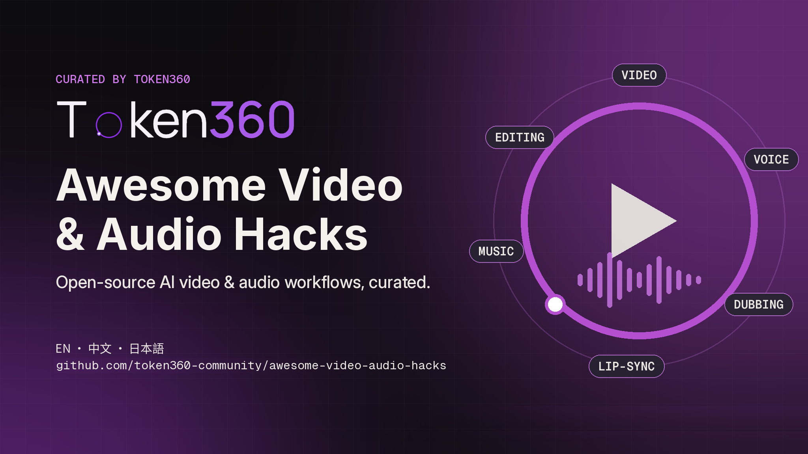

<h1 align="center">
  
  <br />
  Awesome Video &amp; Audio Hacks
</h1>

<!-- 由 scripts/generate_readme.py 从 data/catalog.json 生成，请勿手改。 -->

<p align="center">
  <a href="./README.md">EN</a> · <strong>简体中文</strong> · <a href="./README.ja.md">日本語</a>
</p>

<p align="center">
  <a href="https://awesome.re"></a>
  
  
  
</p>

> 一份严格筛选、逐条核验的 AI **视频、配音、翻译配音、对口型、剪辑**清单，收录开源工作流、Agent Skill、MCP server，以及可以照着复现的帖子。每一条都要过书面门槛（见[参与贡献](#参与贡献)），每个分类最多 5 条。由 [Token360](https://www.token360.ai/zh-CN?utm_source=github&utm_medium=awesome&utm_campaign=avah) 开发者社区维护。

**标签：** `Repo` `Skill` `MCP` `Node` `Post` `Person` `List` · ⛔ 仅链接（非商用或 source-available 许可） · ⚠️ 商用前请先看备注

⚡ 表示“只改 `base_url` 和 key 就能在 Token360 上跑通，并已验证”。目前还没有任何条目带 ⚡：都还没测过。

<sub>共 42 条，10 个分类 · 最近核验 2026-10-11</sub>

## Token360 快速上手

Token360 用一个 OpenAI 兼容的 `base_url` 提供文本、图像和视频模型。

```python
import os
from openai import OpenAI

client = OpenAI(base_url="https://api.token360.ai/v1", api_key=os.environ["TOKEN360_API_KEY"])
resp = client.chat.completions.create(
    model="deepseek-v4.1-flash",
    messages=[{"role": "user", "content": "Write a 3-shot storyboard for a 10-second product teaser."}],
)
print(resp.choices[0].message.content)
```

```bash
# Video: create a task, then poll GET /videos/{id} until it completes
curl https://api.token360.ai/v1/videos \
  -H "Authorization: Bearer $TOKEN360_API_KEY" -H "Content-Type: application/json" \
  -d '{"model": "seedance-2.5", "prompt": "A paper-cut crane takes off over a misty lake"}'
```

| 模态 | 接口                              | 模型 id 示例                                                         |
| ---- | --------------------------------- | -------------------------------------------------------------------- |
| 文本 | `POST /chat/completions`          | `claude-sonnet-5-5`, `gpt-6-sol`, `deepseek-v4.1-flash`              |
| 图像 | `POST /images/generations`        | `gpt-image-2`, `dola-seedream-5.0-pro`, `nano-banana-2`              |
| 视频 | `POST /videos → GET /videos/{id}` | `seedance-2.5`, `veo-3.1-generate-001`, `wan3.0-video`, `minimax-h3` |
| 音频 | _待验证_                          | `seed-audio-1.0`, `glm-asr-2512`                                     |

<sub>模型 id 取自 2026-10-11 公开的 `GET /v1/models`。不带 key 请求时这些路由返回鉴权错误；本列表里的项目都还没在 Token360 上端到端跑过。</sub>

完整模型列表和每个模型的请求示例：[token360.ai/models](https://www.token360.ai/zh-CN/models?utm_source=github&utm_medium=awesome&utm_campaign=avah)。

## 目录

- [视频生成与提示词](#视频生成与提示词) (5)
- [短剧与叙事](#短剧与叙事) (5)
- [剪辑与动效 Agent](#剪辑与动效-agent) (5)
- [配音、TTS 与音乐](#配音tts-与音乐) (5)
- [翻译配音与字幕](#翻译配音与字幕) (4)
- [对口型与数字人](#对口型与数字人) (3)
- [ComfyUI 与 MCP 连接器](#comfyui-与-mcp-连接器) (4)
- [工作流拆解（帖子）](#工作流拆解帖子) (4)
- [值得关注的作者](#值得关注的作者) (4)
- [相关列表](#相关列表) (3)

## 视频生成与提示词

- [HKUDS/ViMax](https://github.com/HKUDS/ViMax) - `Repo` · ⭐ 12.6k · MIT · Agent 化的视频生成流水线：创意 → 剧本 → 分镜 → 镜头，导演、编剧、制片多个 Agent 分工协作。
- [Emily2040/seedance-2.0](https://github.com/Emily2040/seedance-2.0) - `Skill` · ⭐ 7.6k · MIT · 面向 Seedance 2.0 的制作流程 Skill，覆盖文本、图像、视频、音频四种输入的 AI 影片制作。
- [zhouwei713/seedance-prompt](https://github.com/zhouwei713/seedance-prompt) - `Skill` · ⭐ 327 · MIT · 为 Seedance 等文生视频模型编写写实风格视频提示词的 Agent Skill。
- [liyue-aigc/seedance-2-5-video-director](https://github.com/liyue-aigc/seedance-2-5-video-director) - `Skill` · ⭐ 616 · MIT · Seedance 2.5 视频导演 Skill：提示词、脚本、诊断、人物锁定、续写、编辑与转场。
- [s1dashu/director](https://github.com/s1dashu/director) - `Skill` · ⭐ 801 · MIT · 从调研、脚本、视觉设定、镜头设计、素材生成到交付，端到端“导演”一条完整视频的 Skill。

## 短剧与叙事

- [HBAI-Ltd/Toonflow-app](https://github.com/HBAI-Ltd/Toonflow-app) - `Repo` · ⭐ 17.2k · MIT · 可本地部署的短剧/漫剧制作工具：剧本、智能分镜、角色与场景资产、图像和视频生成，基于无限画布与 Agent。
- [MemeCalculate/moyin-creator](https://github.com/MemeCalculate/moyin-creator) - `Repo` · ⭐ 4.7k · AGPL-3.0 · AI 影视生产工具：剧本到成片全流程批量化，支持 Seedance 2.0。
- [xuanyustudio/LocalMiniDrama](https://github.com/xuanyustudio/LocalMiniDrama) - `Repo` · ⭐ 2k · MIT · 本地优先的 AI 短剧/漫剧工具：故事 → 分镜 → 成片，项目数据留在本机。
- [zenstory-ai/drama-skills](https://github.com/zenstory-ai/drama-skills) - `Skill` · ⭐ 2.7k · MIT · 适配 Claude Code 与 Codex 的 AI 短剧 Skill 合集：剧本、角色资产、分镜、图片/视频提示词与审查。
- [eternityspring/shuohao-skills](https://github.com/eternityspring/shuohao-skills) - `Skill` · ⭐ 4.4k · Apache-2.0 · AI 短剧前期制作 Skill：拆角色、排大纲、场景与道具设定、写剧本、切分镜。

## 剪辑与动效 Agent

- [calesthio/OpenMontage](https://github.com/calesthio/OpenMontage) - `Repo` · ⭐ 66.9k · AGPL-3.0 · Agent 化的视频制作系统：把 AI 编程助手变成完整的视频生产流水线，内置多条现成流程和工具。
- [heygen-com/hyperframes](https://github.com/heygen-com/hyperframes) - `Repo` · ⭐ 60.9k · Apache-2.0 · 写 HTML 就能渲染视频的动效框架，专为 Agent 调用设计。
- [Vincentwei1021/video-shotcraft](https://github.com/Vincentwei1021/video-shotcraft) - `Skill` · ⭐ 11.3k · Apache-2.0 · 用 Remotion 做电影感产品视频的 Claude Code / Codex Skill：镜头配方卡、动效预览和生产模板。 ⚠️ 依赖 Remotion 渲染，Remotion 自身许可对部分公司商用场景要求付费授权。
- [digitalsamba/claude-code-video-toolkit](https://github.com/digitalsamba/claude-code-video-toolkit) - `Skill` · ⭐ 2.2k · MIT · 面向 Claude Code 的 AI 原生视频制作工具包。
- [luoluoluo22/jianying-editor-skill](https://github.com/luoluoluo22/jianying-editor-skill) - `Skill` · ⭐ 3.9k · MIT · 让 Agent 自动操作剪映草稿、完成剪辑的 Skill。

## 配音、TTS 与音乐

- [RVC-Boss/GPT-SoVITS](https://github.com/RVC-Boss/GPT-SoVITS) - `Repo` · ⭐ 62.7k · MIT · 少样本声音克隆与 TTS：约 1 分钟参考音频即可训练出可用的声音。
- [OpenBMB/VoxCPM](https://github.com/OpenBMB/VoxCPM) - `Repo` · ⭐ 39k · Apache-2.0 · 无分词器的多语种 TTS，支持声音设计与声音克隆。
- [resemble-ai/chatterbox](https://github.com/resemble-ai/chatterbox) - `Repo` · ⭐ 26.9k · MIT · Resemble AI 开源的 TTS 模型。
- [QwenAudio/CosyVoice](https://github.com/QwenAudio/CosyVoice) - `Repo` · ⭐ 23.9k · Apache-2.0 · 多语种语音生成大模型，提供推理、训练和部署全套能力。
- [remsky/Kokoro-FastAPI](https://github.com/remsky/Kokoro-FastAPI) - `Repo` · ⭐ 5.5k · Apache-2.0 · Kokoro-82M 的 Docker 化 OpenAI 兼容语音接口，支持 CPU/GPU，可输出字幕时间戳。

## 翻译配音与字幕

- [Huanshere/VideoLingo](https://github.com/Huanshere/VideoLingo) - `Repo` · ⭐ 18.8k · Apache-2.0 · 字幕切分、翻译、对齐乃至配音，一条全自动流水线。
- [jianchang512/pyvideotrans](https://github.com/jianchang512/pyvideotrans) - `Repo` · ⭐ 19.3k · GPL-3.0 · 把视频翻译成另一种语言，并嵌入配音和字幕。
- [buxuku/SmartSub](https://github.com/buxuku/SmartSub) - `Repo` · ⭐ 5.6k · MIT · 跨 Windows / macOS / Linux 的桌面工具：本地转写、字幕翻译、AI 配音和字幕烧录。
- [m-bain/whisperX](https://github.com/m-bain/whisperX) - `Repo` · ⭐ 24.5k · BSD-2-Clause · 带词级时间戳和说话人分离的语音识别。

## 对口型与数字人

- [MeiGen-AI/InfiniteTalk](https://github.com/MeiGen-AI/InfiniteTalk) - `Repo` · ⭐ 8k · Apache-2.0 · 音频驱动、不限时长的说话视频生成，支持图生视频和视频生视频。
- [KlingAIResearch/LivePortrait](https://github.com/KlingAIResearch/LivePortrait) - `Repo` · ⭐ 19.2k · MIT · 用驱动视频让静态肖像动起来。 ⚠️ 代码是 MIT，但自带的 InsightFace 检测模型仅限非商用，商用需替换。
- [Jingyi-Wu-Richael/rachel-digital-human-production](https://github.com/Jingyi-Wu-Richael/rachel-digital-human-production) - `Skill` · ⭐ 1.1k · MIT · 制作经授权的数字人口播视频的 Codex Skill：先校验素材、先出短预览，确认后才生成完整视频。

## ComfyUI 与 MCP 连接器

- [Comfy-Org/ComfyUI](https://github.com/Comfy-Org/ComfyUI) - `Repo` · ⭐ 136.9k · GPL-3.0 · 节点式的图像、视频、音频扩散模型工作流引擎与界面。
- [NikoDemon80/ComfyUI-H3-Motion-Context](https://github.com/NikoDemon80/ComfyUI-H3-Motion-Context) - `Node` · ⭐ 1.2k · GPL-3.0 · 串联 MiniMax H3 片段的 ComfyUI 节点，让动作和声音在衔接处连贯；附示例工作流。
- [artokun/comfyui-mcp](https://github.com/artokun/comfyui-mcp) - `MCP` · ⭐ 811 · MIT · MCP server 加侧边栏 Agent，让大模型搭建、运行和修改 ComfyUI 的图像/视频/音频工作流。 ⚠️ README 写明目前为有限维护（只修关键问题）。
- [pireel/pireel](https://github.com/pireel/pireel) - `MCP` · ⭐ 1.3k · AGPL-3.0 · 带画布和时间轴的开源视频编辑器，可由 AI Agent 通过 MCP 驱动。

## 工作流拆解（帖子）

- [@GeekCatX — 4 步做 Vox 风格解说视频](https://x.com/GeekCatX/status/2078488413045747814) - `Post` · 2026-07 · 视频生成 · 四步：Codex + vox-style skill 拆分镜写提示词，图像模型批量出图，视频模型逐镜生成，最后自动剪辑成片。
- [@newbeeyu — 用 Codex + Remotion 做唐朝纸片分层动画](https://x.com/newbeeyu/status/2076530524110369070) - `Post` · 2026-07 · 剪辑与动效 · X 长文：用 Codex + Remotion 以代码制作唐朝纸片分层动画，讲清分层、节奏和分层音效。
- [@EXM7777 — 在 Claude Code 里搭一条 AI 视频制作流水线](https://x.com/EXM7777/status/2082107255449919582) - `Post` · 2026-07 · 剪辑与动效 · X 长文：把 Claude Code 搭成一条视频制作流水线，并列出做镜头规划时参考的素材来源。
- [@Pluvio9yte — Codex + Hyperframes + HeyGen + 声音克隆全流程](https://x.com/Pluvio9yte/status/2081580929492131947) - `Post` · 2026-07 · 配音与 TTS · X 长文：Codex 主控、Hyperframes 做动效、HeyGen 做数字人、IndexTTS 做配音的短视频全流程。

## 值得关注的作者

- [@HeyAbhishek](https://x.com/HeyAbhishek) - `Person` · EN · Seedance 动画提示词 · 分享电影感 AI 动画短片背后的完整提示词。代表作: [帖子](https://x.com/HeyAbhishek/status/2106369769956065518)。
- [@liyue_ai](https://x.com/liyue_ai) - `Person` · 中文 · Seedance 导演 Skill · 在 GitHub（liyue-aigc）开源 Seedance 导演类 Skill。代表作: [帖子](https://x.com/liyue_ai/status/2093592225162960982)。
- [@Pluvio9yte](https://x.com/Pluvio9yte) - `Person` · 中文 · Agent 视频流水线 · 长文拆解 Codex + Hyperframes 视频流水线及其背后的 Skill。代表作: [帖子](https://x.com/Pluvio9yte/status/2081648099680743554)。
- [@GeekCatX](https://x.com/GeekCatX) - `Person` · 中文 · 低成本解说视频流程 · 用 Agent 加图像/视频模型做低成本解说视频的分步流程。代表作: [帖子](https://x.com/GeekCatX/status/2078488413045747814)。

## 相关列表

- [LearnPrompt/awesome-seedance](https://github.com/LearnPrompt/awesome-seedance) - `List` · ⭐ 2k · MIT · Seedance 2.5 / 2.0 提示词库：案例可追溯到原帖，附模板和可安装的视频 Skill。
- [ZeroLu/awesome-seedance](https://github.com/ZeroLu/awesome-seedance) - `List` · ⭐ 2.7k · MIT · Seedance 2.0 提示词、指南和视频生成工作流合集。
- [freestylefly/awesome-gpt-image-2](https://github.com/freestylefly/awesome-gpt-image-2) - `List` · ⭐ 34.3k · MIT · GPT Image 2 / 2.5 提示词与案例库，附模板；适合做视频前的关键帧和分镜。

## 参与贡献

只改 `data/catalog.json`（不要直接改 README），运行 `python3 scripts/generate_readme.py`，再提 PR。提交前请先读 [CONTRIBUTING.zh-CN.md](./CONTRIBUTING.zh-CN.md) 里的门槛，不达标的条目会直接关闭。

---

<sub>列表内容以 [CC0 1.0](./LICENSE) 发布。所链接的项目、帖子和商标归各自所有者；收录不代表对方背书，也不代表 Token360 背书。</sub>
